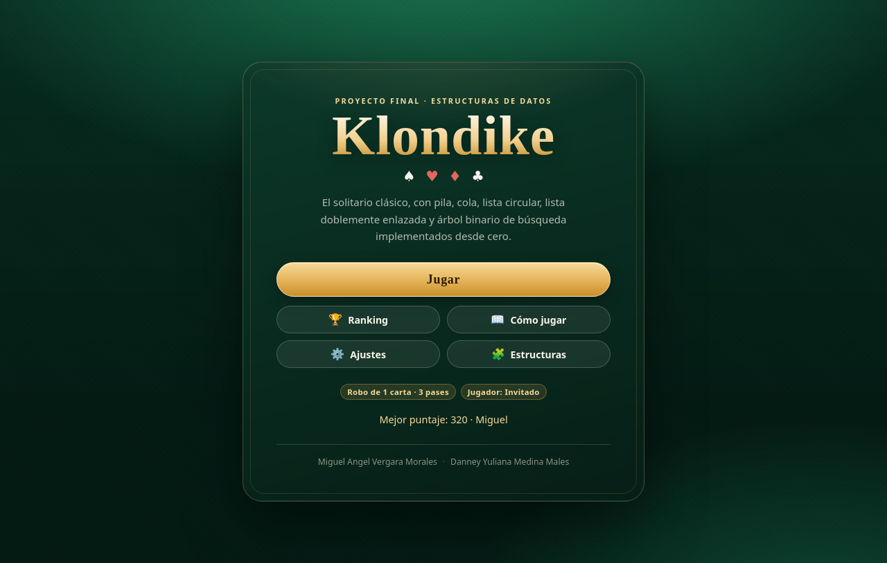

# Klondike — Solitario en JavaScript

Proyecto final de **Estructuras de Datos**. Juego de solitario Klondike completo, con interfaz gráfica,
cinco estructuras de datos implementadas desde cero y documentación en español.



## Integrantes

- **Miguel Angel Vergara Morales**
- **Danney Yuliana Medina Males**

El detalle del aporte de Danney, sus seis pruebas de refuerzo y la revisión del manual de usuario están
en [`docs/aporte-danney.md`](docs/aporte-danney.md).

## Características

- Reparto y reglas completas del Klondike.
- Robo de **1 carta** (clásico) o **3 cartas**.
- **3 pases**, **5 pases** o **pases ilimitados**.
- Selección con destinos válidos, arrastrar y soltar y doble clic a la fundación.
- Deshacer y rehacer cualquier cantidad de movimientos.
- Pistas, autocompletado y rendición.
- Ranking local con los 10 mejores puntajes.
- Inspector de estructuras en vivo.
- Diseño adaptable a móvil y controles de teclado.
- Sin frameworks, sin librerías externas y sin proceso de compilación.

## Estructuras implementadas

| Estructura | Archivo | Uso principal en el juego |
|---|---|---|
| Pila (LIFO) | `src/structures/Stack.js` | Descarte, cuatro fundaciones y pilas de deshacer/rehacer. |
| Cola (FIFO) | `src/structures/Queue.js` | Mazo de robo y reparto inicial. |
| Lista circular | `src/structures/CircularList.js` | Control de los pases y cursor del pase actual. |
| Lista doblemente enlazada | `src/structures/DoublyLinkedList.js` | Las siete columnas y los grupos que se mueven entre ellas. |
| Árbol binario de búsqueda | `src/structures/BST.js` | Ranking de mejores puntajes; la clave es el puntaje. |

Las cinco están construidas con nodos y referencias. No se usan arreglos del lenguaje para simular su
comportamiento. La justificación de cada elección y las tablas de complejidad están en el manual técnico.

## Cómo ejecutar

El juego usa módulos ES, por lo que debe abrirse desde un servidor HTTP local (no con doble clic en
`index.html`).

```bash
cd ProyectoFinal
python3 -m http.server 8000
```

Luego abrir:

- **Juego:** <http://localhost:8000>
- **Pruebas:** <http://localhost:8000/tests/>
- **Pruebas de refuerzo:** <http://localhost:8000/tests/danney.html>

También se puede usar la extensión **Live Server** de VS Code o publicar la rama `main` con GitHub
Pages.

## Pruebas

La suite se ejecuta en el navegador y no tiene dependencias:

```text
40 pruebas aprobadas · 0 fallidas · 40 total
```

Incluye pruebas de las cinco estructuras, del motor del juego, de las reglas, del ranking, de las
pistas, de la rendición, de los pases ilimitados y de la validación de instantáneas. La evidencia
completa está en [`docs/pruebas.html`](docs/pruebas.html) y en
[`docs/Pruebas_Klondike.pdf`](docs/Pruebas_Klondike.pdf).

La suite de refuerzo de Danney se ejecuta en `/tests/danney.html` y reporta:

```text
6 pruebas aprobadas · 0 fallidas · 6 total
```

## Documentación

| Documento | HTML | PDF |
|---|---|---|
| Manual de usuario | [`docs/manual-usuario.html`](docs/manual-usuario.html) | [`docs/Manual_Usuario_Klondike.pdf`](docs/Manual_Usuario_Klondike.pdf) |
| Manual técnico | [`docs/manual-tecnico.html`](docs/manual-tecnico.html) | [`docs/Manual_Tecnico_Klondike.pdf`](docs/Manual_Tecnico_Klondike.pdf) |
| Evidencia de pruebas | [`docs/pruebas.html`](docs/pruebas.html) | [`docs/Pruebas_Klondike.pdf`](docs/Pruebas_Klondike.pdf) |
| Diagrama de clases | [`docs/diagrama-clases.svg`](docs/diagrama-clases.svg) | Incluido en el manual técnico |

El aporte individual de Danney, con las seis pruebas de refuerzo y la revisión del manual de usuario,
está documentado en [`docs/aporte-danney.md`](docs/aporte-danney.md).

El diagrama también está disponible como imagen PNG y como fuente editable de Graphviz:

- [`docs/diagrama-clases.png`](docs/diagrama-clases.png)
- [`docs/diagrama-clases.dot`](docs/diagrama-clases.dot)

## Estructura del proyecto

```text
ProyectoFinal/
├── index.html
├── src/
│   ├── main.js
│   ├── config.js
│   ├── structures/     # Las cinco estructuras propias
│   ├── game/           # Lógica independiente del DOM
│   ├── ui/             # Vistas, modales e inspector
│   └── utils/          # DOM, almacenamiento y aleatoriedad
├── styles/             # base.css, board.css, cards.css, modals.css
├── tests/              # Runner y pruebas
└── docs/               # Manuales, diagrama, PDFs y capturas
```

## Puntaje

| Acción | Puntos |
|---|---:|
| Mover una carta a una fundación | +10 |
| Voltear una carta del tablero | +5 |
| Devolver una carta de la fundación al tablero | −15 |
| Reciclar el descarte | −20 |
| Completar la partida | +100 |

El puntaje nunca baja de cero.

## Estado del proyecto

Proyecto **completo** para la entrega del **20 de noviembre de 2026, 6:00 p. m.**

- Juego funcional de inicio a fin.
- 40 pruebas automatizadas aprobadas.
- Manual de usuario y manual técnico en HTML y PDF.
- Diagrama de clases y evidencia de pruebas.
- Repositorio con historial de commits del equipo.

## Repositorio

<https://github.com/pandahacker0211-max/klondike-solitario>
