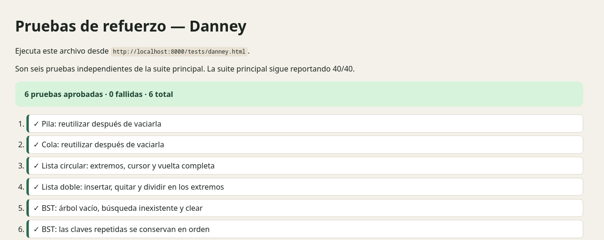

# Aporte de Danney Yuliana Medina Males

Este documento resume mi aporte al proyecto final **Klondike — Solitario en JavaScript** de la
asignatura **Estructuras de Datos**.

## 1. Resumen

Mi aporte se concentra en dos tareas:

1. **Pruebas de refuerzo de las cinco estructuras**, en un archivo independiente de la suite
   principal.
2. **Revisión funcional del manual de usuario**, comprobando que las instrucciones coincidan con el
   juego real.

Las pruebas de refuerzo no reemplazan ni modifican las 40 pruebas existentes. Se ejecutan en una
página aparte y comprueban casos límite que complementan la cobertura: reutilización de estructuras
vacías, operaciones en los extremos, vueltas del cursor circular y comportamiento del BST con claves
repetidas.

## 2. Archivos que agregué

| Archivo | Contenido |
|---|---|
| `tests/danney.test.js` | Seis pruebas de refuerzo de las estructuras. |
| `tests/danney.html` | Página independiente para ejecutar solo esas seis pruebas. |
| `docs/aporte-danney.md` | Este documento. |
| `docs/img/11-pruebas-danney.png` | Captura del resultado 6/6. |

La suite principal (`tests/index.html`, `tests/structures.test.js` y `tests/game.test.js`) queda
intacta y sigue reportando **40 pruebas aprobadas**.

## 3. Pruebas agregadas

| # | Prueba | Qué comprueba |
|---|---|---|
| 1 | Pila: reutilizar después de vaciarla | Después de extraer todos los elementos, la pila acepta nuevos `push`, conserva el orden LIFO y vuelve a quedar vacía correctamente. |
| 2 | Cola: reutilizar después de vaciarla | Después de extraer todos los elementos, la cola acepta nuevos `enqueue`, conserva el orden FIFO y el frente vuelve a ser válido. |
| 3 | Lista circular: extremos, cursor y vuelta completa | Insertar al inicio y al final, mover el cursor con `setCursor` y `advance`, dar la vuelta completa, eliminar en los extremos y reutilizar la lista vacía. |
| 4 | Lista doble: insertar, quitar y dividir en los extremos | Insertar en las cuatro posiciones principales, eliminar primero y último, recorrer hacia atrás, `splitFrom(0)`, `splitFrom(size)` y errores de rango. |
| 5 | BST: árbol vacío, búsqueda inexistente y `clear` | Un árbol vacío tiene altura 0, no encuentra claves, no elimina nada y `clear` lo deja reutilizable. También se comprueba la altura de un árbol con varias ramas. |
| 6 | BST: claves repetidas en orden | Los puntajes repetidos se conservan, el recorrido inorden los devuelve ordenados y cada `delete` elimina una sola ocurrencia. |

## 4. Cómo ejecutar las pruebas

Desde la raíz del proyecto:

```bash
python3 -m http.server 8000
```

Luego abrir en el navegador:

```text
http://localhost:8000/tests/danney.html
```

El resultado esperado es:

```text
6 pruebas aprobadas · 0 fallidas · 6 total
```



La suite principal se sigue ejecutando en:

```text
http://localhost:8000/tests/
```

y debe mostrar:

```text
40 pruebas aprobadas · 0 fallidas · 40 total
```

## 5. Revisión del manual de usuario

Revisé el archivo `docs/Manual_Usuario_Klondike.pdf` (18 páginas) y comprobé los siguientes puntos:

- [x] El índice y los títulos de las secciones coinciden con el contenido.
- [x] Las reglas del Klondike descritas en el manual coinciden con el juego.
- [x] Los controles de ratón, arrastrar y soltar, doble clic y teclado funcionan como se explica.
- [x] Las capturas corresponden a la interfaz actual.
- [x] Las instrucciones para iniciar el servidor y abrir el juego son correctas.
- [x] La explicación de los ajustes de robo y pases coincide con las opciones disponibles.
- [x] La sección de preguntas frecuentes resuelve las dudas básicas de un jugador nuevo.
- [x] No encontré enlaces internos rotos ni textos cortados.

## 6. Explicación breve para la sustentación

- **Pila:** el último elemento que entra es el primero que sale. Se usa en el descarte, en las
  fundaciones y en el historial de deshacer.
- **Cola:** el primero que entra es el primero que sale. Se usa en el mazo, porque las cartas se
  roban siempre por el frente.
- **Lista circular:** después del último pase se vuelve al primero. El cursor indica el pase actual y
  `advance()` lo mueve en O(1).
- **Lista doblemente enlazada:** cada columna se recorre hacia adelante y hacia atrás, y `splitFrom`
  permite separar un grupo de cartas sin reconstruir la columna.
- **Árbol binario de búsqueda:** el ranking se guarda por puntaje. El recorrido inorden devuelve las
  entradas ordenadas y permite obtener el top 10. Las claves repetidas se conservan a la derecha.

## 7. Comandos utilizados

```bash
git clone https://github.com/pandahacker0211-max/klondike-solitario.git
cd klondike-solitario
git config user.name "Danney Yuliana Medina Males"
git config user.email "yulianaackerman36@gmail.com"
git checkout -b aporte-danney

# Crear los archivos tests/danney.test.js, tests/danney.html y docs/aporte-danney.md.
# Copiar la captura en docs/img/11-pruebas-danney.png.

git add tests/danney.test.js tests/danney.html docs/aporte-danney.md docs/img/11-pruebas-danney.png
git commit -m "test: pruebas de refuerzo de estructuras y revisión del manual"
git push -u origin aporte-danney
```

Después de subir la rama, se crea un *pull request* hacia `main` y se revisa que la suite principal
siga en 40/40 y que la suite nueva esté en 6/6.

## 8. Conclusión

Las seis pruebas refuerzan los casos límite de las estructuras y dejan evidencia de que las
operaciones básicas siguen siendo correctas después de vaciar, reutilizar y eliminar elementos. La
revisión del manual de usuario confirma que la documentación y el juego coinciden.
